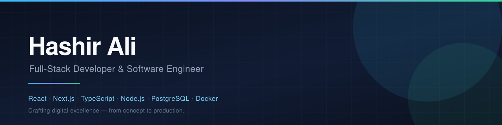

# Hashir Ali

### Full-Stack Developer & Software Engineer

**React · Next.js · TypeScript · Node.js · PostgreSQL · Docker**

<a href="https://hashirali-portfolio.vercel.app/">Portfolio</a> ·
<a href="https://www.linkedin.com/in/hashir-ali-978620279/">LinkedIn</a> ·
<a href="https://x.com/Hashir_But">X</a> ·
<a href="https://integrallabs.tech/">Integral Labs</a> ·
<a href="mailto:hashirbutt2610@gmail.com">Email</a>

---

## Professional Introduction

I am a full-stack software engineer and Computer Science student at **FAST NUCES**, building scalable full-stack applications, AI-powered systems, and interactive digital experiences. My work runs the length of the stack: modern front-ends in React and Next.js, backend architecture in Node.js and PostgreSQL, systems programming in C and C++, and real-time 3D interfaces with Three.js, React Three Fiber, WebGL, and GLSL.

I founded and lead **[Integral Labs](https://integrallabs.tech/)** — a remote-first software studio serving startups, enterprises, and growing brands across time zones. Alongside client delivery I run independent R&D: the projects where the constraint is curiosity rather than a client brief.

My standard is simple: understand the problem properly, build the thing that solves it, and leave it fast, documented, and maintainable for whoever touches it next.

---

## Professional Manifesto

**Understanding before implementation.** I read the problem domain before I open an editor. The most expensive bugs are the ones written confidently into the wrong requirement.

**Depth over surface area.** I would rather own a system end to end — schema, API, interface, deployment — than rent the middle of somebody else's abstraction.

**Build for the person who inherits it.** Documented, readable, conventional. Code is read far more often than it is written, and usually by someone who is not me.

**Ship, then refine.** A working artifact in front of a user teaches more than a month of speculation. I prototype early, measure honestly, and let evidence set the direction.

**State what is verified and what is not.** I would rather hand over a documented gap than a confident guess. Claims I make are claims I have exercised.

**Design is engineering.** Performance, accessibility, and visual clarity are correctness properties of the product, not polish applied at the end.

**Learn in public, build in the open.** Every project is a chance to test a technique, and every technique learned is a tool the next project gets for free.

---

## Metrics

Cards are generated daily by [`.github/workflows/summary-cards.yml`](.github/workflows/summary-cards.yml) from live GitHub activity. Set a `SUMMARY_GITHUB_TOKEN` repository secret to include private-repository work in the numbers.

---

## Technology Stack

**Frontend**

**Backend & Data**

**Systems, Mobile & Tooling**

| Area | Working with |
|---|---|
| Frontend | React, Next.js, TypeScript, Tailwind CSS, React Three Fiber |
| Backend | Node.js, Express, Python, FastAPI, REST APIs, WebSockets |
| Databases | PostgreSQL, MongoDB, Oracle SQL, Prisma, Payload CMS |
| Systems | C, C++, Bash, Linux, multithreading, socket programming |
| Graphics | Three.js, WebGL, GLSL shaders, real-time rendering |
| Tooling | Git, Docker, Figma, VS Code, Postman |

---

## Selected Work

| Project | Year | What it is | Stack |
|---|---|---|---|
| **CARZ** | 2026 | Full-stack car marketplace for buying, renting, and managing vehicles, with customer, driver, and owner workflows, owner analytics, real-time messaging, and 3D vehicle visualisation | Next.js · Node.js · PostgreSQL · WebSocket · Three.js |
| **DTOME** | 2026 | Distributed Trading & Order Matching Engine — a multithreaded C++ exchange simulator with a limit order matching core, TCP client-server architecture, and a Qt trading terminal | C++ · Qt · TCP · Multithreading |
| **VaultMesh** | 2025 | Personal file management and monitoring system covering storage operations, automation, and system-level programming | C · C++ · Bash · Linux |
| **Allo Finance** | 2024 | Finance platform front-end with interactive data visualisations and motion design | Next.js · React · Three.js · WebGL |
| **XIM** | 2024 | Interactive public landing page with immersive 3D web experiences | Next.js · React Three Fiber · WebGL · Tailwind CSS |
| **ISIM** | 2024 | Responsive interactive digital platform | Next.js · React · Tailwind CSS |
| **Fitness App** | 2024 | Workout tracking and progress monitoring for mobile | React Native · Firebase · JavaScript |
| **Shopping Portal** | 2023 | E-commerce platform for browsing products and managing purchases | React · Node.js · MongoDB · REST API |

<a href="https://hashirali-portfolio.vercel.app/projects">→ Full project index</a>

---

## International Service

Working with startups, enterprises, and growing brands worldwide to create fast, scalable, and visually exceptional digital experiences.

**Fiverr — Level 1 Seller · 5.0 / 5 from 4 reviews**

<a href="https://www.fiverr.com/hashir_ali_b?public_mode=true">Fiverr</a> ·
<a href="https://www.upwork.com/freelancers/~0147ff18dd1e58b6e3?viewMode=1">Upwork</a> ·
<a href="https://hashirali-portfolio.vercel.app/freelance">Client work</a>

> "One of the best web developers I have ever worked with — and I have worked with a lot of them. Professional, communicates very well, fast work, high quality, and willing to work with you on changes. I cannot recommend him enough."
> — **Mike Lyles**, Allo Finance

> "Excellent work and a real pleasure to work with. Hashir built exactly what I needed, clear communication, fast replies, and he delivered everything clean and well documented so I can edit it myself later."
> — **Joe**, Author

> "Working with Hashir Ali on my website development project was an absolute pleasure. His timely communication and politeness made the process seamless. Highly recommend."
> — **helder silva**, Majic Books

---

## Education & Recognition

**FAST NUCES** — BS Computer Science · **COMMECS** — Secondary Education

| Award | Year | Recognition |
|---|---|---|
| IBA Hackathon | 2024 | Solutions built under time constraints, focused on creativity, problem solving, and technical execution |
| Dean's List | 2024 | Outstanding academic performance in Computer Science |
| Dev Day Hackathon | 2024 | Technical solutions built and presented through rapid prototyping |

**Continuous learning:** Frontend Masters (advanced React, Next.js, TypeScript) · Database Systems and Data Modelling · Linux Terminal and Systems Programming · Node.js and Backend Architecture · OOP and DSA via LeetCode and Pluralsight

<a href="https://hashirali-portfolio.vercel.app/education/awards">→ Awards</a> ·
<a href="https://hashirali-portfolio.vercel.app/education/courses">→ Courses</a>

---

### Plan the present. Build the future.

**Open to freelance builds, performance audits, and long-term engineering partnerships.**

<a href="mailto:hashirbutt2610@gmail.com">hashirbutt2610@gmail.com</a> ·
<a href="https://www.linkedin.com/in/hashir-ali-978620279/">LinkedIn</a> ·
<a href="https://hashirali-portfolio.vercel.app/">hashirali-portfolio.vercel.app</a>

